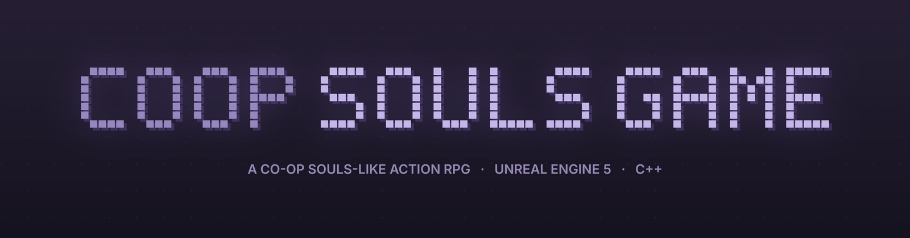

  

  

<h2 align="center"><b>Overview</b></h2>
 

CoopSoulsGame is a dark fantasy melee combat game inspired by the Souls genre. Every gameplay system is written in <b>C++</b> — Blueprints are used only for asset assignment. The focus is precise, skill-based combat with a polished, weighty feel.

<i>Built by one developer across gameplay programming, technical animation and world building.</i>

  

<h2 align="center"><b>🎮 Features</b></h2>
 

<table>
<tr>
<td width="50%" valign="top">
<h3 align="center"><b>Player Combat</b></h3>
<ul>
<li>Dual combat modes — <b>Two-Handed Sword</b> / <b>Sword &amp; Shield</b></li>
<li>Light, heavy and hold-release <b>charge attacks</b></li>
<li><b>Cross-cancel combos</b> — light ↔ heavy mid-chain</li>
<li><b>Parry</b> windows driven by anim notifies</li>
<li>Stamina-based <b>guarding</b> with light/heavy reactions</li>
<li><b>Dodge roll</b> with i-frames</li>
<li><b>Lock-on</b> with smooth camera interpolation</li>
<li><b>Backstab executions</b> with positional snap</li>
<li>Jump attacks, sprint, stamina &amp; mana</li>
</ul>
</td>
<td width="50%" valign="top">
<h3 align="center"><b>Enemies &amp; Boss</b></h3>
<ul>
<li><code>ACoopEnemy</code> base class — patrol / chase / attack AI</li>
<li><b>Poise &amp; stagger</b> — stumble, injured idle, backstab-vulnerable</li>
<li>Randomized 3-attack set with <b>counter-hit stun</b></li>
<li>Parry-able attacks that deal poise damage</li>
<li><b>Boss: <i>Greata The Trid</i></b> — dedicated <code>ACoopBossEnemy</code> (2.5× scale)</li>
<li>Separate boss sword actor with <b>per-tick sweep collision</b></li>
<li>Smooth tracking rotation, locked during attacks</li>
</ul>
</td>
</tr>
<tr>
<td width="50%" valign="top">
<h3 align="center"><b>Animation</b></h3>
<ul>
<li>Montage-driven combat layered over locomotion (<code>DefaultSlot</code>)</li>
<li><b>Custom C++ anim notify</b> classes for every combat event</li>
<li>Blend-space locomotion fed by <code>GroundSpeed</code> from C++</li>
<li>Separate Animation Blueprints per character type</li>
<li>IK Retargeter pipeline</li>
</ul>
</td>
<td width="50%" valign="top">
<h3 align="center"><b>UI &amp; Split-Screen</b></h3>
<ul>
<li>Per-player HUD — health, stamina, mana</li>
<li>Enemy health bars isolated <b>per viewport</b></li>
<li><code>SetOwnerPlayer</code> / <code>SetOwningLocalPlayer</code> for correct split-screen rendering</li>
</ul>
</td>
</tr>
</table>

  

<h2 align="center"><b>Gallery</b></h2>
 

<h3 align="center"><b>Boss Fight — <i>Greata The Trid</i></b></h3>
 

<table>
<tr>
<td></td>
<td></td>
<td></td>
</tr>
</table>

 

<h3 align="center"><b>Combat</b></h3>
 

<table>
<tr>
<td></td>
<td></td>
</tr>
<tr>
<td></td>
<td></td>
</tr>
</table>

 

<h3 align="center"><b>World Building</b></h3>
 

<table>
<tr>
<td></td>
<td></td>
</tr>
<tr>
<td></td>
<td></td>
</tr>
</table>

 

<b>🔧 Under the hood — debug view of weapon sweep collision</b>

 

  

<h2 align="center"><b>Architecture</b></h2>
 

<pre>
ACharacter
 └── ACoopSoulsGameCharacter
      ├── ACoopSwordCharacter
      └── ACoopArcherCharacter

ACoopEnemy  ─────────────►  ACoopEnemyAIController (timer-based state machine)
 └── ACoopBossEnemy  ──────►  ACoopBossSword (TipMarker → BaseMarker sweep)
</pre>

<ul>
<li><b>Weapon hits</b> — socket-to-socket <code>SweepMultiByChannel</code> every tick during the attack window</li>
<li><b>Enemy AI</b> — custom controller with timer-driven states and tick-based facing</li>
<li><b>Scalable enemies</b> — boss inherits from the base enemy, overriding stats, scale and montage set</li>
<li><b>Split-screen UI</b> — per-player viewport isolation via <code>SetOwnerPlayer</code> / <code>SetOwningLocalPlayer</code></li>
</ul>

  

<h2 align="center"><b>Tech Stack</b></h2>
 

<table>
<tr><th>Area</th><th>Tools</th></tr>
<tr><td><b>Engine</b></td><td>Unreal Engine 5.7</td></tr>
<tr><td><b>Gameplay</b></td><td>C++ (systems) · Blueprint (asset config only)</td></tr>
<tr><td><b>IDE / Build</b></td><td>Visual Studio 2022 · Unreal Header Tool</td></tr>
<tr><td><b>AI</b></td><td>Custom AIController · NavMesh pathfinding</td></tr>
<tr><td><b>Animation</b></td><td>IK Retargeter · Blend Spaces · Montages · C++ Anim Notifies</td></tr>
</table>

  

<h2 align="center"><b>Project Status</b></h2>
 

<table>
<tr><th>System</th><th>Status</th></tr>
<tr><td>Single-player combat</td><td>✅ Stable</td></tr>
<tr><td>Enemy AI &amp; poise</td><td>✅ Stable</td></tr>
<tr><td>Boss encounter</td><td>✅ Playable</td></tr>
<tr><td>Co-op split-screen</td><td>🔄 Built — re-integrating after solo testing</td></tr>
</table>

  

<h2 align="center"><b>About Me</b></h2>
 

<b>Joel Shajan</b> — Multi-discipline game developer · Bangalore, India

Gameplay Programming · Technical Animation · 3D Art &amp; World Building

<b>Email:</b> <a href="mailto:joelshajankuttu@gmail.com">joelshajankuttu@gmail.com</a>

<i>Open to roles in gameplay programming, technical animation and generalist game dev.</i>

